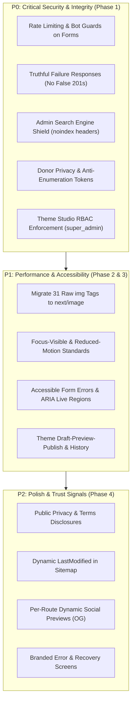

# Production Hardening Plan & Audit Roadmap

**Project:** Bisnouli Sarvodaya Gramodyog Sewa Sansthan (BSGSS)  
**Repository:** `https://github.com/Anheuserly/bisnoulisansthan.git`  
**Branch:** `chore/prod-hardening-phase-0`  
**Specification Version:** `1.0.0`  
**Execution Autonomy:** High with checkpoints (Phase 1, Phase 3, Phase 5)  
**Strict Principle:** Production hardening only. **NO redesign. NO visual changes. NO scope creep.**

---

## 1. Executive Summary of Open Audit Items

Extracted from `docs/COMPLETE_WEBSITE_AUDIT.md` and reconciled against the live codebase:



---

## 2. Public API Route Inventory & Security Posture (Task 0.2)

Audit of all public API endpoints accepting traffic:

| Endpoint | Method | Input Validation | Bot / Rate Limiting | Persistence Error Handling | Runtime DDL Risk |
|---|---|---|---|---|---|
| `/api/contact` | `POST` | Manual length check & regex. **No Zod.** | ❌ **None** (unlimited POSTs allowed) | ❌ **False Success**: Returns `ok: true` (HTTP 201) when DB fails! | None |
| `/api/join` | `POST` | Manual length check & regex. **No Zod.** | ❌ **None** (unlimited POSTs allowed) | ❌ **False Success**: Returns `ok: true` (HTTP 201) when DB fails! | ❌ **High**: Executes `CREATE TABLE IF NOT EXISTS` on every POST request |
| `/api/donations` | `POST` | Manual length check, amount check. **No Zod.** | ❌ **None** (unlimited POSTs allowed) | ❌ **False Success**: Returns `ok: true` (HTTP 201) when DB fails! | ❌ **High**: Executes `CREATE TABLE IF NOT EXISTS` on every POST request |
| `/api/donations` | `GET` | String query slicing (`query`, `ref`). **No Zod.** | ❌ **None** (permits brute-force enumeration) | ⚠️ Returns generic 500 on DB failure. | ❌ **High**: Executes `CREATE TABLE IF NOT EXISTS` on every GET request |
| `/api/customize` | `GET` | None needed (read-only settings) | None (public read) | ✅ Gracefully returns fallback settings | None |
| `/api/theme` | `GET` | None needed (read-only theme) | None (public read) | ✅ Gracefully returns default theme | None |

---

## 3. Admin Routes & Search Engine Shield Inventory (Task 0.5)

Audit of all administration surfaces and indexing posture:

| Route Path | Type | Layout Metadata (`robots`) | `robots.ts` Disallow | `next.config.ts` (`X-Robots-Tag`) |
|---|---|---|---|---|
| `/admin` | Dashboard | ✅ `index: false, follow: false` | ✅ Disallowed (`/admin/`) | ❌ **Missing header** |
| `/admin/login` | Authentication | ✅ `index: false, follow: false` | ✅ Disallowed (`/admin/`) | ❌ **Missing header** |
| `/admin/setup` | First-time setup | ✅ `index: false, follow: false` | ✅ Disallowed (`/admin/`) | ❌ **Missing header** |
| `/admin/admins` | Admin management | ✅ `index: false, follow: false` | ✅ Disallowed (`/admin/`) | ❌ **Missing header** |
| `/admin/content` | Content ledger | ✅ `index: false, follow: false` | ✅ Disallowed (`/admin/`) | ❌ **Missing header** |
| `/admin/customize` | Customizer Studio | ✅ `index: false, follow: false` | ✅ Disallowed (`/admin/`) | ❌ **Missing header** |
| `/admin/donations` | Donation ledger | ✅ `index: false, follow: false` | ✅ Disallowed (`/admin/`) | ❌ **Missing header** |
| `/admin/inquiries` | Contact inbox | ✅ `index: false, follow: false` | ✅ Disallowed (`/admin/`) | ❌ **Missing header** |
| `/admin/join` | Applications inbox | ✅ `index: false, follow: false` | ✅ Disallowed (`/admin/`) | ❌ **Missing header** |
| `/admin/theme` | Theme studio | ✅ `index: false, follow: false` | ✅ Disallowed (`/admin/`) | ❌ **Missing header** |
| `/api/admin/*` | Admin REST APIs | N/A (JSON responses) | ✅ Disallowed (`/api/`) | ❌ **Missing header** |

**Remediation in Phase 1:** Inject `X-Robots-Tag: noindex, nofollow` into `next.config.ts` headers for `/admin/:path*` and `/api/:path*`.

---

## 4. Prioritized Engineering Checklist

### Phase 0 — Reconnaissance & Baseline (Current)
- [x] Read `docs/COMPLETE_WEBSITE_AUDIT.md` end-to-end.
- [x] Create feature branch `chore/prod-hardening-phase-0`.
- [x] Produce `docs/hardening/images-to-migrate.md` (31 raw `` tags inventoried).
- [x] Produce `docs/hardening/baseline.md` (build metrics, test passing status, advisories).
- [x] Produce `docs/hardening/PLAN.md` (route inventory, security posture, admin robots analysis).
- [x] Confirm no source files modified.

---

### Phase 1 — P0 Security Hardening (Highest Impact)
*Target branch:* `chore/prod-hardening-phase-1`  
*Requires Human Review Gate:* Yes, after Phase 1 completion.

- [ ] **1.1 Rate-Limiting & Bot-Guard Public Forms**
  - [ ] Implement `lib/ratelimit.ts` with sliding-window limiter keyed by SHA-256 hashed IP + route.
  - [ ] Add Redis/Upstash adapter with graceful in-memory Map fallback for local/offline environments.
  - [ ] Add hidden honeypot field (`website_hp_guard`) to contact, join, and donation forms; discard silently if filled.
  - [ ] Support optional Cloudflare Turnstile behind feature flag `TURNSTILE_ENABLED`.
  - [ ] Return standard HTTP 429 with `Retry-After` header when limit exceeded.
- [ ] **1.2 Search Engine Shield on Admin Routes**
  - [ ] Verify `app/admin/layout.tsx` retains `robots: { index: false, follow: false }`.
  - [ ] Ensure `app/robots.ts` explicitly disallows `['/admin/', '/api/', '/support/certificate/']`.
  - [ ] Add `X-Robots-Tag: noindex, nofollow` header in `next.config.ts` for `/admin/:path*` and `/api/:path*`.
- [ ] **1.3 Harden Donation Certificate Lookup & Anti-Enumeration**
  - [ ] Eliminate broad `ILIKE %query%` wildcards on donation lookups.
  - [ ] Require matching donor email OR 128-bit high-entropy lookup token.
  - [ ] Return uniform 404 error message for both non-existent and unverified lookups.
  - [ ] Provide idempotent migration script for database schema (`lib/db/migrations/003_harden_donations.sql`).
- [ ] **1.4 Role-Based Access Control on Theme API**
  - [ ] Enforce `role === 'super_admin'` for `POST` and `PUT` on `/api/admin/theme`.
  - [ ] Restrict `editor` role to preview / GET operations; return 403 Forbidden with structured error.
- [ ] **1.5 Fail Truthfully on Persistence Errors**
  - [ ] Eliminate false success (`ok: true`, 201) responses when database inserts fail.
  - [ ] Return HTTP 503 Service Unavailable with user-safe retry guidance.
  - [ ] Remove in-handler runtime `CREATE TABLE IF NOT EXISTS` DDL statements from API routes.

---

### Phase 2 — P1 Performance & Accessibility
*Target branch:* `chore/prod-hardening-phase-2`

- [ ] **2.1 Migrate Raw `` to `next/image`**
  - [ ] Migrate all 14 marketing page images per `docs/hardening/images-to-migrate.md`.
  - [ ] Migrate all 14 shared component images with explicit width, height, and responsive `sizes`.
  - [ ] Restrict `priority` to `Logo.tsx` and the first `HomeHero.tsx` slide.
  - [ ] Eliminate Cumulative Layout Shift (target CLS $\le$ 0.1).
- [ ] **2.2 Focus-Visible & Reduced-Motion**
  - [ ] Configure global `:focus-visible` styling (`outline: 2px solid var(--brand-500)`).
  - [ ] Wrap keyframe animations in `@media (prefers-reduced-motion: no-preference)`.
  - [ ] Integrate `useReducedMotion` hooks in carousel and marquee elements.
- [ ] **2.3 Accessible Form Error Handling**
  - [ ] Add `aria-live="assertive"` error summary announcements.
  - [ ] Programmatically focus first invalid input on validation failure.
  - [ ] Associate inputs with validation errors via `aria-describedby`.
- [ ] **2.4 Defer Heavy Third-Party Modules**
  - [ ] Defer SVG map and video embeds using dynamic imports (`next/dynamic` with `ssr: false`).
  - [ ] Click-to-load video facade with reserved aspect-ratio container.

---

### Phase 3 — Theme Admin Robustness
*Target branch:* `chore/prod-hardening-phase-3`  
*Requires Human Review Gate:* Yes, after Phase 3 completion.

- [ ] **3.1 Draft → Preview → Publish Workflow**
  - [ ] Introduce `status: 'draft' | 'published'` in theme persistence.
  - [ ] `getActiveTheme()` continues serving strictly `published` configuration.
  - [ ] Generate signed preview URL (expires in 24 hours).
- [ ] **3.2 Theme Versioning & Immutable History**
  - [ ] Create `theme_history` table (`id`, `config_json`, `published_by`, `published_at`).
  - [ ] Implement `POST /api/admin/theme/rollback/:id` for super_admins.
- [ ] **3.3 Stale LocalStorage Preview Expiry**
  - [ ] Store preview payloads with timestamp `{ config, savedAt }`.
  - [ ] Expire and ignore preview tokens older than 24 hours.
- [ ] **3.4 Zod Schema for Theme Configuration**
  - [ ] Define comprehensive `ThemeConfigSchema` with color hex, enum, and typography guards.
  - [ ] Unify client and server validation.

---

### Phase 4 — P2 Polish & Compliance
*Target branch:* `chore/prod-hardening-phase-4`

- [ ] **4.1 Public Trust Pages**
  - [ ] Publish `/privacy` and `/terms` with statutory non-profit data handling declarations.
  - [ ] Link trust pages from global footer and donation modals.
- [ ] **4.2 Real Timestamps in Sitemap**
  - [ ] Derive `lastModified` in `app/sitemap.ts` from database records rather than `new Date()`.
- [ ] **4.3 Per-Route Dynamic OpenGraph Previews**
  - [ ] Generate route-specific social cards using `@vercel/og`.
- [ ] **4.4 Branded Error & Recovery Screens**
  - [ ] Add branded `app/error.tsx`, `app/loading.tsx`, and `app/not-found.tsx`.
- [ ] **4.5 Field Web Vitals Telemetry**
  - [ ] Lightweight, privacy-compliant client Web Vitals reporting.

---

## 5. Exit Criteria & Checkpoints

```
[Phase 0: Recon & Baseline] --> Checkpoint: Human Review & Approval
                                     ↓
[Phase 1: P0 Security]      --> Checkpoint: Human Review & Approval
                                     ↓
[Phase 2: Performance/A11y] --> Continuous Execution
                                     ↓
[Phase 3: Theme Robustness] --> Checkpoint: Human Review & Approval
                                     ↓
[Phase 4: Polish]           --> Final Validation & Handover
```
